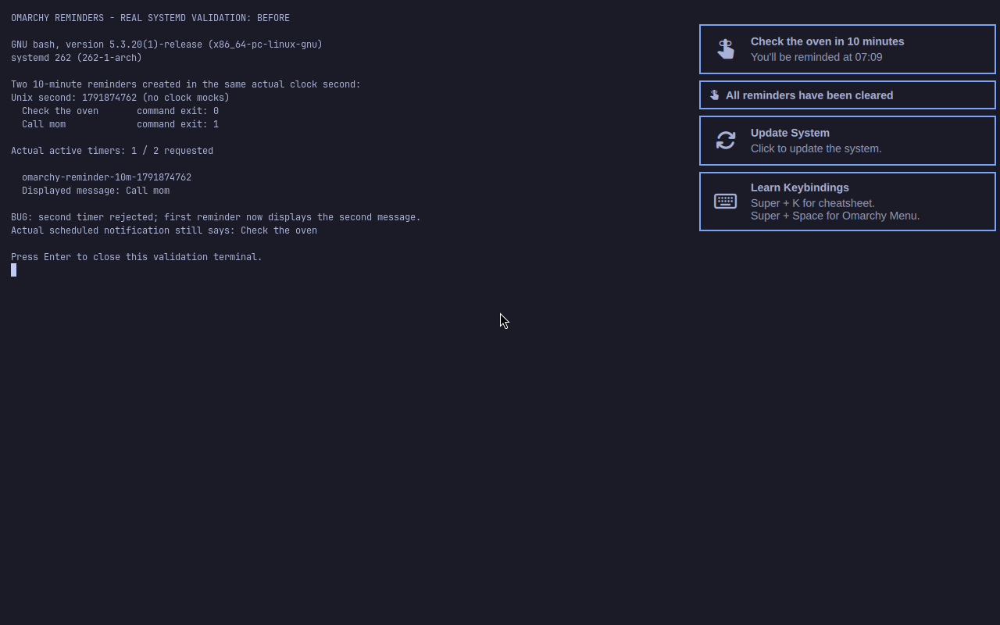
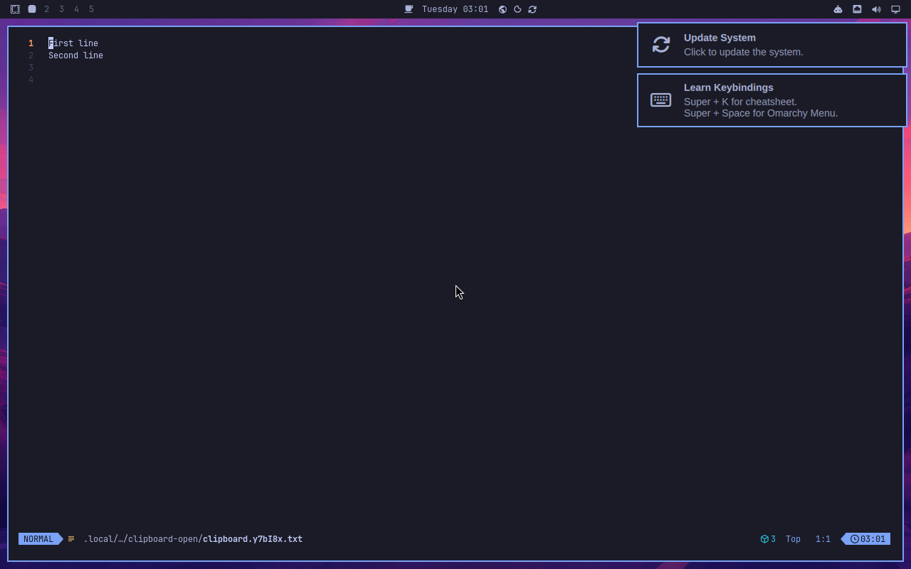

# Omarchy: same-second reminder collision validation

Source: omacom/omarchy quattro `47caa9b`. Candidate changes only `bin/omarchy-reminder` and adds `test/shell.d/reminder-unit-collision-test.sh`.

Two `omarchy reminder 10` calls made within the same natural Unix second use the same transient unit. The second call exits 1 because systemd refuses the duplicate timer, after overwriting the first reminder's stored message. The displayed reminder then differs from the actual notification scheduled by the first service.

The fix reserves a unique message filename atomically with coreutils mktemp, derives the systemd unit from it, and removes the reservation if creation fails. No new runtime dependency. Existing list/clear prefixes are retained.

## Real runtime evidence

Official Omarchy image `omarchy-edge-2026.10.12.442.qcow2`, SHA256 `7ed0bd351861bce80c43434a9fb48fe6058dc12dbdb0bde2b14e59d7fe9d4110`, x86_64 KVM virtual machine, unchanged cached image with temporary copy-on-write disk. Bash 5.3.20, coreutils 9.12, systemd 262, jq 1.8.2, Python 3.14.8, Foot 1.28, wtype 0.4. All runtime dependencies are installed in the official image; versions recorded in dependencies.txt.

`repro_omarchy_reminder_collision.py` runs the original and candidate scripts against real user systemd timers and the actual desktop notification server, with no mocked date, systemd, or notification command. before.json and after.json record actual seconds, exit codes, timer listing and service ExecStart. Before: one timer, second command exit 1, first displayed message overwritten. After: two timers, both commands exit 0, messages retained.

The screenshots below are actual full-screen Omasnap captures of the Foot terminal running that reproduction in the native Omarchy Wayland session. They are unedited. Desktop notifications are the actual create confirmations.

### Before

### After

12 concurrent calls against real systemd also created 12 unique timers with exact messages, and clear stopped every timer; parallel.json/native-parallel.log record the result.

## Automated verification

Host and native VM: 7 collision/ownership/list/clear/failure-cleanup assertions and 9 pre-existing reminder input assertions passed. Final regression fails on unmodified upstream at the second creation, both on host and native. Host command metadata/routing CLI suite: 125 passing assertions. Native timer creation and notification delivery are separate from the mocked systemd/date unit-test fixtures. Full graphical acceptance suite not claimed.

Host CLI setup reused an isolated extracted gawk 5.3.2 package plus a workspace-only python alias. No changes to the host system configuration. Host dependency details are in host-dependencies.json.

## Duplicate check

Open PR search for the command returned 15 PRs. Inspected actual patches for reminder proposals 15186 (reboot persistence), 15136 and 11082 (clock-time support/management), 10679 (suspend), 11009 (notification persistence). All retain seconds-only unit naming; none fixes this collision. The snapshot and patches are included. Launch wrapper quoting was excluded because it already has duplicate open fixes.

Two one-minute real timers also fired naturally after 61.5 seconds. D-Bus notification bodies were exactly `Native firing verification` and `Your 1 minutes are up`; both reserved message files were removed and active count became zero. See firing.json/native-firing.log.

The initial concurrent run log records an additional real reproduction: one timer was rejected. The deterministic sequential same-second run shown in before.png is recorded by before.json and before-call-1.log/before-call-2.log, and demonstrates message overwrite as well.

Review follow-up: commit `04b012f6e17b047a7a5e0bb0a3c7b2432c2cc589` updates docs/notifications.md with `<epoch>-<random>` and the atomic reservation explanation. The runtime file still matches the native-tested hash. Final PR now changes three files including documentation; original screenshot and runtime evidence is unchanged. See final-fix.patch and review-followup.json.
